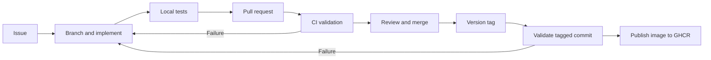

# Retail Data Pipeline

A **production-oriented, end-to-end retail data pipeline** built with Python, Apache Airflow, PostgreSQL, and Docker, featuring automated data quality controls and CI/CD validation.

## Executive Summary


## Overview
This project demonstrates how raw, inconsistent retail product data can be transformed into reliable, analytics-ready datasets through an automated data engineering workflow.
It combines data ingestion, transformation, orchestration, quality assurance, and software delivery practices in a reproducible environment.


## Technical summary


## Key Features

- **Automated Data Pipeline:** Orchestrates ingestion, transformation, and database loading using Apache Airflow.
- **Data Transformation:** Standardizes product attributes and resolves duplicate SKUs while retaining audit records.
- **Data Quality Assurance:** Implements 18 Soda checks across PostgreSQL staging and core layers.
- **Automated Testing:** Validates Python logic, database integration, and end-to-end pipeline execution.
- **CI/CD & Security:** Uses GitHub Actions for automated validation, container builds, vulnerability scanning, and versioned image publishing workflows.
- **Containerization:** Runs the pipeline with Docker Compose for reproducible local development.

## Technologies Used

| Component | Technologies |
|---|---|
| Programming & Transformation | Python, pandas |
| Orchestration | Apache Airflow |
| Data Storage | PostgreSQL |
| Data Quality | Soda |
| Containerization | Docker, Docker Compose |
| Testing | pytest |
| CI/CD & Security | GitHub Actions, Ruff, Trivy |
| Dependency Management | uv |


## workflow
**Issue → Branch → Implementation → Tests → Pull Request → CI → Review → Merge**

The pipeline ingests a product CSV, preserves raw observations in PostgreSQL
staging, and loads cleaned, deduplicated products into core. Airflow coordinates
the work; Soda validates both database layers.

### Project status

The CI validation pipeline has passed, including the end-to-end run and image
security gate. Versioned image publishing is configured; deployment is outside
the current scope. See [CI and releases](docs/ci-cd.md) for verification details.

### Development and release cycle



CI checks tests and lint, builds the runtime image, validates Airflow and
PostgreSQL, runs the pipeline end to end, and scans the image for security
findings. Publishing uses the validated image after a successful version-tag
run. See the [pipeline guide](docs/ci-cd.md) for the gates and release steps.

## What we learned

- Working code is only the start: reproducible environments, review, testing,
  and container builds make changes dependable.
- Unit tests, real service integration, and end-to-end runs catch different
  problems. A passing unit suite alone cannot validate an Airflow deployment.
- Data quality rules need explicit business decisions. Preserve raw evidence,
  handle invalid records deliberately, and fail the pipeline on violated rules.
- Dependency resolution does not guarantee runtime compatibility. Test the
  imports and execution paths the application actually uses.
- Security findings need investigation: update real vulnerable dependencies,
  reconcile stale inventories, and document narrowly verified exceptions.

## Current capabilities

- Load UTF-8 CSV files as strings and validate required ingestion columns.
- Preview the default product dataset from the command line.
- Normalize product text, categories, prices, stock, dates, countries,
  currencies, and active-status values.
- Select the latest observation for duplicate SKUs while returning duplicate
  rows for audit.
- Run Soda quality gates after staging and core loads: seven staging checks
  and 11 core checks covering schema, completeness, uniqueness, and validity.
- Validate code, Docker builds, Airflow DAGs, PostgreSQL, and full pipeline runs
  in GitHub Actions, with image vulnerability gates and version-tag publishing.

## Requirements

- Python 3.12
- [uv](https://docs.astral.sh/uv/)

## Setup

From the repository root:

```powershell
uv sync --locked
uv run pytest -q
```

For the local Airflow stack, follow the [Docker and Airflow guide](docs/development.md#docker-and-airflow).
Once running, open `http://localhost:8080`, unpause both product DAGs, and
trigger **`products_pipeline`**.

## Documentation

- [Architecture](docs/architecture.md) — pipeline and module roles
- [Data cleaning](docs/data-cleaning.md) and [data quality](docs/data-quality.md)
- [Development and testing](docs/development.md) — Python usage, Docker, Airflow, and tests
- [CI and releases](docs/ci-cd.md) — validation, security gates, and publishing
- [Security review](docs/security-review.md)
- [Agent handover](docs/agent-handover.md)


