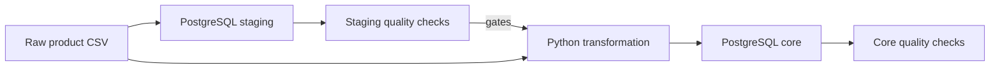

# Retail Data Pipeline

A **production-oriented, end-to-end retail data pipeline** built with Python, Apache Airflow, PostgreSQL, and Docker, featuring automated data quality controls and CI/CD validation.

This project demonstrates how raw, inconsistent retail products data can be transformed into reliable, analytics-ready datasets through an automated data engineering workflow.
It combines data ingestion, transformation, orchestration, quality assurance, and software delivery practices in a reproducible environment.

## Executive Summary

## Technical summary

## Key Features

- **Automated Data Pipeline:** Orchestrates ingestion, transformation, and database loading using Apache Airflow.
- **Data Transformation:** Standardizes product attributes and resolves duplicate SKUs while retaining audit records.
- **Data Quality Assurance:** Implements 18 Soda checks across PostgreSQL staging and core layers.
- **Automated Testing:** Validates Python logic, database integration, and end-to-end pipeline execution.
- **CI/CD & Security:** Uses GitHub Actions for automated validation, container builds, vulnerability scanning, and versioned image publishing workflows.
- **Containerization:** Runs the pipeline with Docker Compose for reproducible local development.
- **CSV ingestion:** Validates required columns and provides a command-line preview of the default dataset.

## Technologies Used

| Component | Technologies |
|---|---|
| Programming & Transformation | Python, pandas |
| Orchestration | Apache Airflow |
| Data Storage | PostgreSQL |
| Data Quality | Soda |
| Containerization | Docker, Docker Compose |
| Testing | pytest |
| CI/CD & Security | GitHub Actions, Ruff, Trivy |
| Dependency Management | uv |

## Data flow

Airflow coordinates the flow and Soda checks both database layers. Staging
preserves raw observations; transformation reads the CSV, cleans and
deduplicates it, then loads core after the staging checks pass.

## Project status

✅ **CI validation passed** in the run reported on 2026-11-17, including the
end-to-end pipeline and image security gate.

```mermaid
flowchart LR
    A[Tests and lint] --> B[Runtime image build]
    B --> C[Airflow and PostgreSQL checks]
    C --> D[End-to-end pipeline and Soda checks]
    D --> E[Image security scan]
    E --> F[Version-tag image publishing configured]
    F -.-> G[Deployment outside current scope]
    classDef passed fill:#dcfce7,stroke:#16a34a,color:#14532d
    classDef configured fill:#eff6ff,stroke:#3b82f6,color:#1e3a8a
    classDef outside fill:#f3f4f6,stroke:#9ca3af,color:#374151
    class A,B,C,D,E passed
    class F configured
    class G outside
```

Publishing is configured for successful version-tag runs but was not separately
confirmed in that report. Deployment is not implemented. See [CI and releases](docs/ci-cd.md)
for verification details.

## Requirements

- Python 3.12
- [uv](https://docs.astral.sh/uv/)

For the local Airflow stack, follow the [Docker and Airflow guide](docs/development.md#docker-and-airflow).
Once running, open `http://localhost:8080`, unpause both product DAGs, and
trigger **`products_pipeline`**.

## Documentation

- [Architecture](docs/architecture.md) — pipeline and module roles
- [Data cleaning](docs/data-cleaning.md) and [data quality](docs/data-quality.md)
- [Development and testing](docs/development.md) — Python usage, Docker, Airflow, and tests
- [CI and releases](docs/ci-cd.md) — validation, security gates, and publishing
- [Security review](docs/security-review.md)
- [Agent handover](docs/agent-handover.md)
